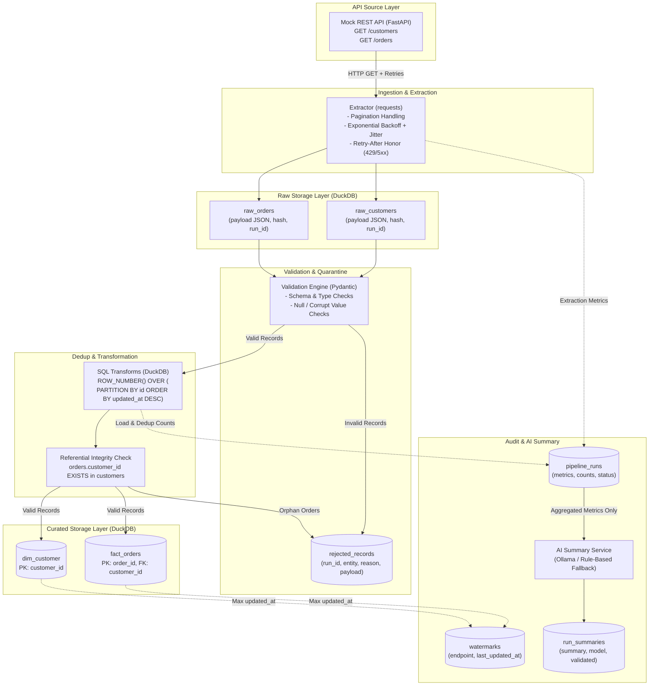

# API-to-Warehouse Ingestion Pipeline (DAI-035)

A robust, idempotent, and audited ELT data pipeline that ingests data from REST API endpoints, normalizes records into a DuckDB analytical warehouse, handles anomalies with automated quarantine, and generates natural-language run summaries using AI.

---

## 1. Problem Statement

Real-world API data is messy: HTTP calls fail intermittently, servers enforce aggressive rate limits (`HTTP 429`), network connections time out, upstream systems produce duplicate records, and incoming payloads contain nulls, corrupt data types, and orphan foreign keys. 

This project solves this challenge by implementing an automated, resilient API-to-Warehouse ingestion engine that survives transient errors, enforces data contracts, protects against duplicates, and operates safely across repeated incremental runs without human intervention.

---

## 2. Approach

The pipeline follows the **Bronze-Silver-Gold (Medallion)** warehouse architecture:
1. **Raw Storage (Bronze):** Ingest raw HTTP response payloads directly into append-only tables alongside a cryptographic SHA-256 hash.
2. **Validation & Quarantine:** Validate data types and schema contracts using Pydantic. Malformed records are diverted into `rejected_records` with detailed failure diagnostics.
3. **Deduplication & Transformation (Silver):** Apply SQL window functions to ensure the latest record per business key wins (`ROW_NUMBER() OVER (...)`). Orphan orders lacking a matching customer are quarantined.
4. **Curated Layer (Gold):** Perform idempotent upserts (`INSERT ... ON CONFLICT DO UPDATE`) into normalized dimensional tables (`dim_customer`, `fact_orders`).
5. **Auditing & AI Summary:** Record comprehensive audit metrics to `pipeline_runs` and generate an operational run summary via an isolated AI service with automatic fallback.

---

## 3. Architecture & Data Flow



---

## 4. Technologies Used

| Concern | Tool / Library | Choice Rationale |
|---|---|---|
| **Language** | Python 3.11+ & SQL | Standard for production data engineering and database transformation |
| **Warehouse** | DuckDB | Embedded analytical columnar engine; serverless, vectorized, supports native JSON and window functions |
| **API Source** | FastAPI & Uvicorn | High-performance async local REST mock with deterministic failure injection |
| **HTTP & Retries** | Requests | Robust HTTP client with custom exponential backoff, jitter, and `Retry-After` header handling |
| **Schema Validation** | Pydantic v2 | Fast type enforcement, field validation, and structured error generation |
| **AI Layer** | Ollama (`llama3.2`) + Fallback | Local LLM inference with deterministic, offline `RuleBasedProvider` fallback |
| **Testing** | Pytest | Fast unit and integration tests using in-memory databases and mocked networking |

---

## 5. Project Structure

```text
api-to-warehouse-pipeline/
├── README.md
├── requirements.txt
├── .gitignore
├── .env.example
├── data/
│   ├── generate_data.py       # Seeded synthetic generator with deliberate anomalies
│   ├── customers.json         # Generated customer fixtures
│   └── orders.json            # Generated order fixtures
├── sql/
│   ├── 01_raw.sql             # Append-only raw JSON tables
│   ├── 02_curated.sql         # Curated dimensional tables (dim_customer, fact_orders)
│   ├── 03_transform.sql       # Window dedup, foreign key check, idempotent upsert
│   └── 04_control.sql         # Audit tables (pipeline_runs, watermarks, run_summaries)
├── src/
│   ├── config.py              # Centralized environment configuration
│   ├── logging_setup.py       # Structured logging with run_id injection
│   ├── mock_api.py            # FastAPI mock server with failure injection
│   ├── extract.py             # Paginated HTTP extractor with retry backoff + jitter
│   ├── validate.py            # Pydantic schema models and quarantine handling
│   ├── load.py                # Database persistence, watermarks, and audit logging
│   ├── pipeline.py            # End-to-end orchestration and CLI entrypoint
│   └── ai/
│       ├── base.py            # SummaryProvider abstract interface
│       ├── rule_based.py      # Deterministic template-based provider (offline fallback)
│       ├── ollama_provider.py # Local Ollama LLM HTTP provider
│       └── summarizer.py      # Prompt construction and numeric validation
├── tests/
│   ├── conftest.py            # In-memory DuckDB fixtures and sample metrics
│   └── test_pipeline.py       # Full test suite covering 9 scenarios
└── docs/
    ├── architecture.md        # Architecture & data flow specification
    └── design_note.md         # Technical decision records and trade-offs
```

---

## 6. Setup Instructions

### Prerequisites
- Python 3.11+
- Git

### 1. Clone & Create Virtual Environment
```bash
git clone https://github.com/Akarsh404/api-to-warehouse-pipeline.git
cd api-to-warehouse-pipeline

python3 -m venv .venv
source .venv/bin/activate
```

### 2. Install Dependencies
```bash
pip install -r requirements.txt
```

### 3. Configure Environment Variables
```bash
cp .env.example .env
```
*(The defaults in `.env.example` work out of the box with zero external configuration.)*

---

## 7. How to Run

### Step 1: Generate Synthetic Data
Generate the deterministic test fixtures:
```bash
python data/generate_data.py --customers 50 --orders 120 --seed 42
```

### Step 2: Start the Mock REST API
In a separate terminal window:
```bash
source .venv/bin/activate
uvicorn src.mock_api:app --host 127.0.0.1 --port 8000 --reload
```

### Step 3: Execute the Data Pipeline
Run the full ingestion pipeline:
```bash
python -m src.pipeline
```

### Optional CLI Arguments:
- `--full-refresh`: Bypasses watermarks to perform a full re-extraction.
- `--fail-rate 0.3`: Simulates a 30% API failure rate to demonstrate retry backoff in logs.
- `--summary-provider ollama`: Selects Ollama local LLM for summary generation (falls back automatically if offline).
- `--db-path path/to/db.duckdb`: Targets a custom warehouse location.

---

## 8. Data Model & Schema

### Raw Layer (`sql/01_raw.sql`)
- `raw_customers`: `(run_id VARCHAR, endpoint VARCHAR, page INTEGER, fetched_at VARCHAR, http_status INTEGER, payload_hash VARCHAR, payload JSON)`
- `raw_orders`: `(run_id VARCHAR, endpoint VARCHAR, page INTEGER, fetched_at VARCHAR, http_status INTEGER, payload_hash VARCHAR, payload JSON)`

### Curated Layer (`sql/02_curated.sql`)
- `dim_customer`: `(customer_id VARCHAR PRIMARY KEY, name VARCHAR, email VARCHAR, country VARCHAR, updated_at VARCHAR, loaded_run_id VARCHAR)`
- `fact_orders`: `(order_id VARCHAR PRIMARY KEY, customer_id VARCHAR, amount DECIMAL(12,2), status VARCHAR, order_ts VARCHAR, updated_at VARCHAR, loaded_run_id VARCHAR)`

### Control Tables (`sql/04_control.sql`)
- `rejected_records`: `(run_id VARCHAR, entity VARCHAR, reason VARCHAR, payload JSON)`
- `pipeline_runs`: `(run_id VARCHAR PRIMARY KEY, started_at VARCHAR, ended_at VARCHAR, status VARCHAR, rows_fetched INT, rows_loaded INT, rows_rejected INT, duplicates_removed INT, retries INT)`
- `watermarks`: `(endpoint VARCHAR PRIMARY KEY, last_updated_at VARCHAR)`
- `run_summaries`: `(run_id VARCHAR PRIMARY KEY, summary VARCHAR, provider VARCHAR, model VARCHAR, prompt_version VARCHAR, validated BOOLEAN)`

---

## 9. AI Approach

The AI summary engine provides operational visibility for data engineers without sitting in the critical path:

1. **Strict Data Isolation (No PII):** Only aggregated run metrics (counts, durations, retries, top rejection reasons) are sent to the model. Raw customer and order records are never shared with LLMs.
2. **Provider Abstraction:** Implements `SummaryProvider(ABC)` with two implementations:
   - `OllamaProvider`: Calls local LLMs (e.g. `llama3.2`) over HTTP.
   - `RuleBasedProvider`: A deterministic template generator that operates 100% offline.
3. **Resilience & Fallback:**
   - If Ollama is offline, times out, or produces anomalous length responses (< 5 words or > 150 words), the pipeline automatically falls back to `RuleBasedProvider`.
4. **Hallucination Guardrail (Numerical Validation):**
   - `validate_summary_numbers()` scans all numbers mentioned in the generated text. If any number deviates from the true pipeline metrics, `validated` is flagged as `False` in `run_summaries`.

---

## 10. Assumptions

1. **Business Keys:** `customer_id` and `order_id` uniquely identify records across time.
2. **Dedup Policy:** When duplicate business keys exist, the record with the latest `updated_at` wins.
3. **Referential Integrity:** Orders referencing non-existent customers cannot enter `fact_orders` and are quarantined to `rejected_records`.
4. **Monetary & Timestamp Formats:** Amounts are positive decimals with two decimal places in a single currency. Timestamps are formatted as ISO-8601 UTC.
5. **Incremental Loading:** Upstream endpoints support filtering via `updated_since`. High-watermarks advance monotonically based on the maximum processed `updated_at`.

---

## 11. Tests Performed

The test suite runs with in-memory DuckDB and mocked HTTP requests (zero network calls).

### Run Test Suite:
```bash
pytest -v
```

### Actual Test Output:
```text
============================= test session starts ==============================
platform darwin -- Python 3.13.5, pytest-8.3.4, pluggy-1.7.0 -- .venv/bin/python3.13
cachedir: .pytest_cache
rootdir: /Users/akarsh/Documents/api-to-warehouse-pipeline
plugins: anyio-4.15.1
collecting ... collected 9 items

tests/test_pipeline.py::test_1_dedup_keeps_latest_updated_at PASSED      [ 11%]
tests/test_pipeline.py::test_2_null_invalid_record_quarantined_not_loaded PASSED [ 22%]
tests/test_pipeline.py::test_3_retry_succeeds_after_two_500_errors PASSED [ 33%]
tests/test_pipeline.py::test_4_retry_exhaustion_marks_run_failed PASSED  [ 44%]
tests/test_pipeline.py::test_5_idempotency_two_runs_identical_counts PASSED [ 55%]
tests/test_pipeline.py::test_6_orphan_order_is_rejected PASSED           [ 66%]
tests/test_pipeline.py::test_7_ai_provider_exception_falls_back_to_rule_based PASSED [ 77%]
tests/test_pipeline.py::test_8_ai_summary_numeric_validation PASSED      [ 88%]
tests/test_pipeline.py::test_watermark_advancement PASSED                [100%]

============================== 9 passed in 0.59s ===============================
```

---

## 12. Sample Output & Results

### Execution Log Excerpt:
```text
2026-10-16 18:56:40 [INFO] [run_id=run_20261016_185640_a1b2c3] pipeline: Initiating pipeline run=run_20261016_185640_a1b2c3
2026-10-16 18:56:40 [INFO] [run_id=run_20261016_185640_a1b2c3] extractor: Starting extraction for endpoint=/customers
2026-10-16 18:56:40 [INFO] [run_id=run_20261016_185640_a1b2c3] extractor: Fetched endpoint=/customers page=1 status=200 records=20
2026-10-16 18:56:40 [INFO] [run_id=run_20261016_185640_a1b2c3] extractor: Fetched endpoint=/customers page=2 status=200 records=20
2026-10-16 18:56:40 [INFO] [run_id=run_20261016_185640_a1b2c3] extractor: Fetched endpoint=/customers page=3 status=200 records=16
2026-10-16 18:56:40 [INFO] [run_id=run_20261016_185640_a1b2c3] raw_loader: Persisted 3 raw pages to warehouse
2026-10-16 18:56:40 [INFO] [run_id=run_20261016_185640_a1b2c3] extractor: Starting extraction for endpoint=/orders
2026-10-16 18:56:40 [INFO] [run_id=run_20261016_185640_a1b2c3] extractor: Fetched endpoint=/orders page=1..7 status=200 records=128
2026-10-16 18:56:40 [INFO] [run_id=run_20261016_185640_a1b2c3] raw_loader: Persisted 7 raw pages to warehouse
2026-10-16 18:56:40 [INFO] [run_id=run_20261016_185640_a1b2c3] transformer: Transform complete: 50 customers loaded (2 dupes removed), 120 orders loaded (2 dupes removed, 2 orphans quarantined)
2026-10-16 18:56:40 [INFO] [run_id=run_20261016_185640_a1b2c3] summarizer: Persisted run summary to run_summaries (validated=True)
2026-10-16 18:56:40 [INFO] [run_id=run_20261016_185640_a1b2c3] pipeline: Pipeline run finished: status=SUCCESS fetched=184 loaded=170 rejected=10 dupes_removed=4 retries=0 duration=0.38s
```

### Aggregated Run Summary:
```text
Pipeline run run_20261016_185640_a1b2c3 finished with status SUCCESS in 0.38 seconds. Ingestion processed 184 total rows, successfully loading 170 records into the warehouse. A total of 4 duplicate records were deduplicated, and 10 records were quarantined. The primary quarantine cause was: 'amount: Value error, Field 'amount' cannot be null'. Operation succeeded with 0 retries; recommend reviewing the rejected_records table for quarantined payloads.
```

### Curated Row Counts:
- `raw_customers`: 3 pages (56 records)
- `raw_orders`: 7 pages (128 records)
- `dim_customer`: 50 unique records
- `fact_orders`: 120 unique records
- `rejected_records`: 10 quarantined rows (4 customers + 4 orders schema failures + 2 orphan orders)

---

## 13. Known Limitations

1. **Single-Node Storage:** DuckDB file storage allows single-process write access, making it unsuitable for multi-threaded distributed writes without coordination.
2. **In-Memory Transformation Volume:** Staging tables and window functions run within the single host machine's memory boundaries.
3. **Sequential Ingestion:** The current extractor processes `/customers` and `/orders` sequentially rather than in parallel asynchronous streams.

---

## 14. What I Would Improve for Production

If deploying this solution in an enterprise data platform:

1. **Orchestrator:** Migrate execution scheduling to Apache Airflow or Dagster to manage DAG dependencies, backfills, and SLA monitoring.
2. **Cloud Analytical Warehouse:** Transition DuckDB to Snowflake, BigQuery, or Databricks for distributed Petabyte-scale queries.
3. **dbt Transformation Layer:** Decouple SQL logic into dbt models with automated documentation, testing (`not_null`, `relationships`), and lineage tracking.
4. **Dead-Letter Queue (DLQ):** Route quarantined records to an Apache Kafka or AWS SQS dead-letter queue for automated alert notifications and triage.
5. **Alerting & Monitoring:** Emit metrics to Prometheus/Datadog and dispatch webhook alerts to PagerDuty/Slack on `PARTIAL` or `FAILED` runs.
6. **Schema Evolution:** Implement schema contract enforcement via a centralized schema registry (e.g. Confluent / Protocol Buffers) to detect breaking API changes.
7. **Secrets Management:** Retrieve credentials and tokens dynamically from AWS Secrets Manager or HashiCorp Vault.
8. **CI/CD & Partitioning:** Implement GitHub Actions for continuous integration testing and partition raw/curated tables by ingestion date (`partition_date=YYYY-MM-DD`).

---

## 15. Tools Disclosure

> Built with assistance from an AI IDE (Antigravity). All design decisions, code and tests were reviewed and understood by me.
