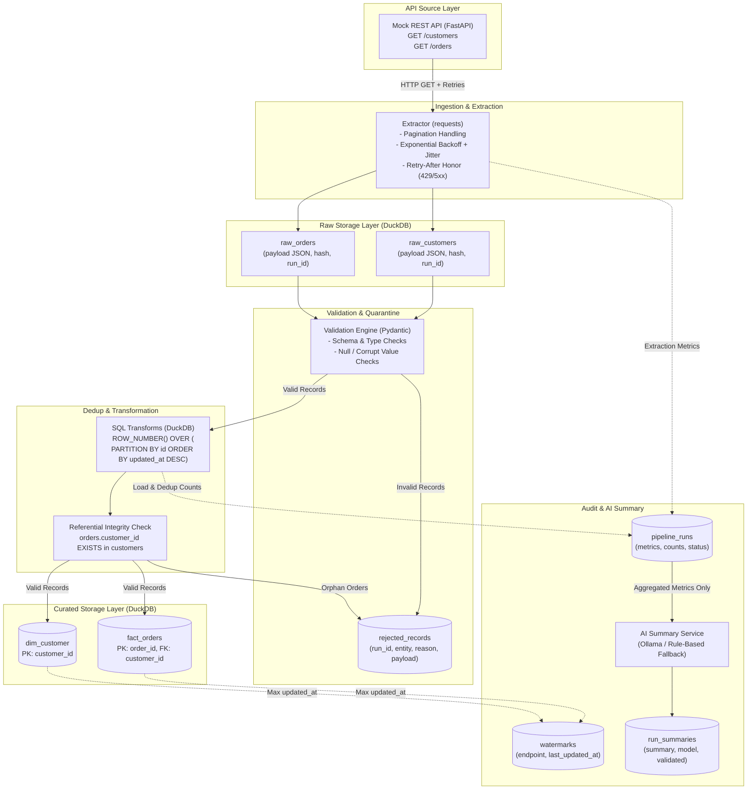

# Pipeline Architecture & Data Flow

This document details the architecture, end-to-end data flow, and design assumptions for the API-to-Warehouse pipeline.

---

## 1. End-to-End Data Flow Diagram



---

## 2. Pipeline Layers

### A. Extraction Layer
- Paginated HTTP GET requests against `/customers` and `/orders`.
- Exponential backoff with random jitter for transient errors (HTTP 429, 5xx, and network timeouts).
- Honors `Retry-After` header when rate limited.
- Non-retryable client errors (HTTP 4xx except 429) fail fast.

### B. Raw Storage Layer (Bronze)
- Append-only tables: `raw_customers` and `raw_orders`.
- Stores raw payload JSON as received, along with SHA-256 `payload_hash`, timestamp, HTTP status, and `run_id`.
- Immutable audit log enabling complete replayability.

### C. Validation & Quarantine Layer
- Pydantic models validate data types, required fields, and format constraints.
- Malformed records are diverted into `rejected_records` with failure reason and original payload.
- Ingestion continues without crashing on individual row failures.

### D. Transformation & Curated Layer (Silver / Gold)
- **Deduplication:** Window functions retain the newest record per business key:
  ```sql
  ROW_NUMBER() OVER (PARTITION BY order_id ORDER BY updated_at DESC) = 1
  ```
- **Referential Integrity:** Orders referencing non-existent `customer_id` values are quarantined into `rejected_records`.
- **Idempotency:** Upserts (`INSERT ... ON CONFLICT DO UPDATE`) guarantee re-running against identical data produces identical curated tables.

### E. Audit & AI Summary Layer
- Every execution logs runtime metrics to `pipeline_runs` (fetched, loaded, rejected, duplicates, retries, duration).
- High-watermark timestamps stored in `watermarks` enable incremental loads.
- The AI Summary Service consumes aggregated metrics (never raw PII) to produce an operational brief.
- An offline `RuleBasedProvider` acts as automatic fallback if the local LLM (Ollama) is unavailable or produces invalid metrics.

---

## 3. Assumptions & Design Constraints

1. **Business Keys:** `customer_id` and `order_id` uniquely identify records across time.
2. **Dedup Precedence:** When duplicates occur, the record with the most recent `updated_at` timestamp takes precedence.
3. **Referential Integrity:** An order cannot exist in curated storage without a matching customer. Unmatched orders are quarantined.
4. **Data Types & Currencies:** Amounts are handled as decimals with two decimal places in a single unified currency. Timestamps follow ISO-8601 UTC.
5. **Incremental Loading:** Endpoints provide `updated_since` query filtering. The pipeline tracks the latest `updated_at` per endpoint in `watermarks`.
6. **Isolated AI Path:** The AI summarizer is non-critical; pipeline execution and warehouse loading succeed regardless of AI availability.
